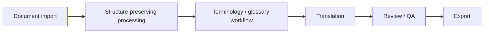

# FolioLoom

**Long-form translation workbench for authors and rightsholders.**

**FolioLoom is currently a pre-MVP project under active development.**

[Website](https://folioloom.com) · [Early Telegram prototype](https://t.me/folioloombot) · [Contact](mailto:hello@folioloom.com)

**Source code access is available on request** for investors, accelerators, technical partners and reviewers. Contact [hello@folioloom.com](mailto:hello@folioloom.com) to discuss access to the private source repository.

## What is FolioLoom

FolioLoom is an independently developed project exploring how authors and rightsholders can guide AI-assisted translation of books, manuscripts and other long documents. Its direction is an author-focused translation workbench: import a document, clarify terminology, generate a draft, review findings and export a usable document.

**DOCX is the current development focus.** TXT and EPUB processing foundations also exist; this does not mean the integrated Workbench is publicly available in any format. The intended workflow is for material the author or rightsholder is authorized to translate.

This repository is a public technical profile of the project. It contains product and architecture documentation; product source code is developed privately.

## Why it exists

Long-form translation brings together recurring names, terminology, context and document structure. Authors also need ways to explain intended meaning when they cannot read the target language.

FolioLoom is being developed to bring those decisions into a reviewable workflow. Whether that approach delivers sufficiently consistent, useful translations remains a question to validate through representative evaluation and author feedback.

## Current status

**Pre-MVP / active development.** The workbench is not publicly available as a finished product.

| Existing capability or foundation | Current boundary |
| --- | --- |
| Working Telegram document-translation prototype | An early interface; processing can fail and translation quality is uneven. |
| TXT, DOCX and EPUB extraction, translation planning and output assembly | Implemented foundations; document fidelity still needs representative validation. |
| Preview, progress, cancellation and document-return flows in the prototype | Existing prototype behavior, not proof of a complete workbench experience. |
| Persistent translation jobs and background workers | Backend foundations, not a production-readiness claim. |
| Glossary preparation and approval prototypes | Terminology controls are under development; reliable end-to-end glossary enforcement is not established. |
| Output checks and document-structure processing | Engineering foundations, not independently demonstrated translation quality. |

The integrated source/translation review workflow and export from an author's reviewed state remain development work. There is no production-readiness or publisher-ready translation claim.

## How it works

The diagram describes the **intended workbench flow**, not a completed end-to-end product:

Two flows explain the project's evolution:

- **Existing prototype:** document upload → preview or confirmation → translation progress → document return through Telegram.
- **Workbench direction:** import and document setup → author terminology decisions → AI-assisted draft → review of translation and structure → export.

The [Telegram prototype](https://t.me/folioloombot) is the early version that started the project. It is not the final interface, and its public link does not imply unrestricted access or reliable availability.

## Technical overview

**Python · FastAPI · PostgreSQL · Redis · Docker · background workers**

The technical work includes format-aware document processing, splitting long documents into translation units, persistent background execution, output assembly, terminology decisions and reviewable quality checks.

The challenge is to connect these pieces without losing document structure or treating an AI-generated draft as a finished translation. Existing backend components and the planned author workflow are at different stages of maturity.

See [Architecture overview](docs/architecture.md) for the high-level processing model and its current limits.

## Development history

FolioLoom began as a personal long-form translation project and a working Telegram bot. Development then shifted toward a dedicated workbench for authors and rightsholders.

| Period | Development milestone |
| --- | --- |
| May 2026 | First working Telegram document-translation prototype. |
| June 2026 | Shift toward an author-focused translation workbench. |
| July 2026 | Workbench visual prototypes and initial glossary interface. |
| Current | Active development of document, terminology and author-workflow foundations. |

### Development activity

The core product is developed in private repositories. Its source history spans months of development: a repository metadata check on **12 October 2026** recorded **801 commits** in the historical source repository's default-branch history, with the latest commit dated **11 October 2026**.

That history can be examined during an agreed private source review. Commit volume is evidence of development activity, not a measure of product readiness or translation quality. Activity in this documentation repository represents public-profile updates rather than the full product's development cadence.

## Product direction

The immediate focus is a controlled DOCX author workflow: terminology decisions, document structure, translation drafts, review and export. Existing TXT/EPUB foundations remain part of the project.

Near-term work is to connect those foundations into a coherent workflow and evaluate the results before broader access. The longer-term direction adds more formats, editing of translated editions and full book design/typesetting capabilities. These are plans, not available features, and no delivery dates are announced. See the [product roadmap](docs/roadmap.md).

## Research notes

[A book needs more than a fluent draft](docs/research/2026-10-19-book-translation.md) — an English research update about terminology, editorial context and document completeness, based on publicly available sources rather than our own customer interviews.

Read the [research page](https://folioloom.com/research/) or inspect the [full source register](docs/research/evidence-register.csv). The register preserves source links, evidence types and verification limits; it is not a count of customers or confirmed incidents.

### Public UI concepts

The following images are already published on [folioloom.com](https://folioloom.com). They are **design prototypes**, not screenshots of a finished application. Example content illustrates the intended experience; it is not evidence of actual users, projects or quality results.

## Private source access

Private source repository access is available **on request** for investors, accelerators, technical partners and reviewers, subject to an agreed review scope and owner approval.

Email [hello@folioloom.com](mailto:hello@folioloom.com) with your organization or role, the purpose of the review and the areas you would like to examine. The scope and access arrangements will be agreed individually.

## Contact

- Website: [folioloom.com](https://folioloom.com)
- Email: [hello@folioloom.com](mailto:hello@folioloom.com)
- Security reports: see [SECURITY.md](SECURITY.md)
