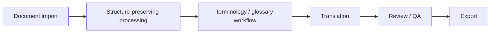

# Architecture overview

FolioLoom combines document processing and AI-assisted translation with an author-focused terminology and review workflow. This is a conceptual overview. It does not describe deployment topology or an already completed workbench.

## Processing model

| Stage | Purpose | Current state |
| --- | --- | --- |
| Document import | Accept authorized TXT, DOCX and EPUB documents. | Format-processing and prototype upload foundations exist. |
| Structure-preserving processing | Extract content and plan translation units while retaining information needed to assemble the document. | Format-aware extraction, planning and assembly exist; fidelity needs continued validation. |
| Terminology / glossary workflow | Let authors clarify recurring terms and approve terminology decisions. | Preparation and approval prototypes exist; complete runtime integration remains development work. |
| Translation | Generate an AI-assisted draft through background processing. | Translation and persistent-worker foundations exist; results can fail or require substantial review. |
| Review / QA | Bring translation, terminology and document-structure findings into a reviewable author workflow. | Output checks exist; the integrated author review experience remains under development. |
| Export | Assemble a translated document reflecting reviewed decisions. | Prototype output assembly exists; export from the complete reviewed workbench state remains development work. |

## General stack

Python, FastAPI, PostgreSQL, Redis, Docker and background workers form the existing technical foundation. Format-aware processing and persistent background jobs address the size and structure of long documents.

## Engineering questions

- How can long-document processing preserve structure across extraction and assembly?
- How should author-approved terminology remain meaningful throughout translation and review?
- How can incomplete or failed processing be represented clearly to an author?
- What evaluation is needed before claiming that a draft is useful and consistent?

These are active engineering and product questions. The existence of individual components does not establish a finished workflow, reliable glossary adherence or production readiness.

[Back to project profile](../README.md)
