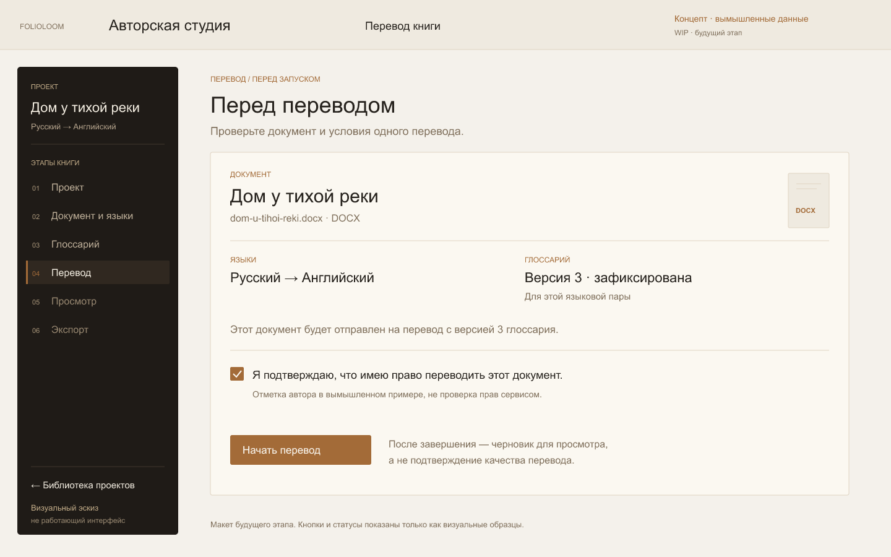
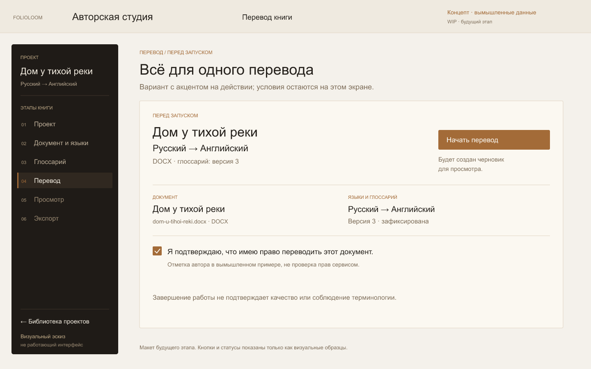
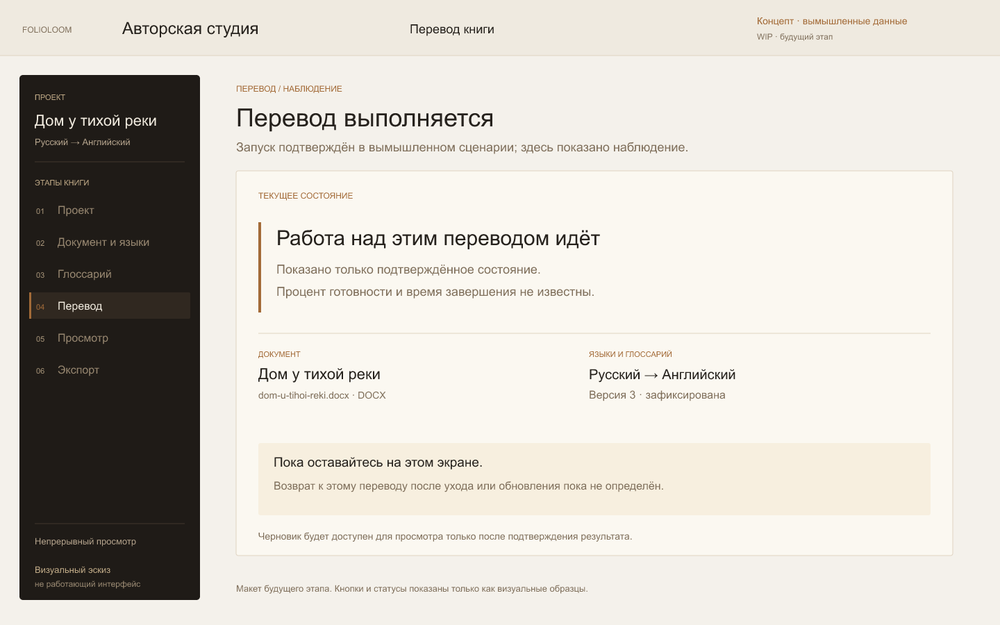
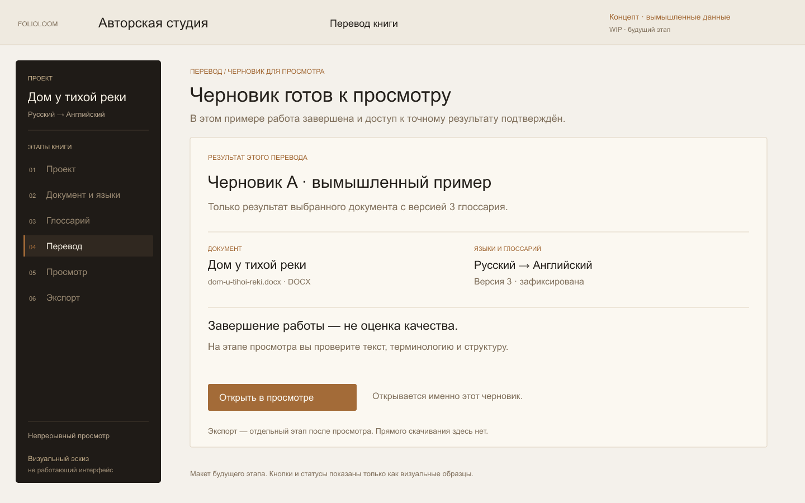
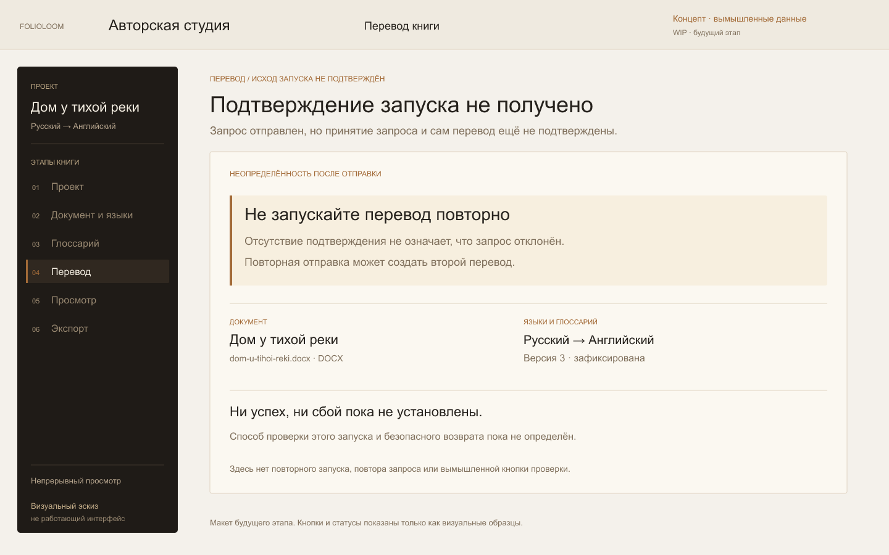

# Вот так может выглядеть экран Translate в FolioLoom

Показываем несколько визуальных концептов будущего шага «Перевод» в авторской студии FolioLoom.

**Это теоретические экраны, а не скриншоты работающей функции.** Все данные вымышлены; кнопки и статусы показаны как визуальные образцы. Композиция, тексты и поведение ещё могут измениться. Публикация не означает, что показанный сценарий уже реализован или доступен пользователям.

Идея — перед запуском держать перед глазами документ, языковую пару и выбранный глоссарий, а после работы вести автора к просмотру черновика, не выдавая завершение за подтверждение качества перевода.

Первые два макета — альтернативные композиции одного состояния, а не последовательные шаги.

## 1. Перед переводом — основной вариант

Документ и условия собраны в одном спокойном рабочем поле.

## 2. Перед переводом — альтернативная композиция

Та же ситуация с более заметным действием запуска. Сравниваем расположение акцентов.

## 3. Перевод выполняется

Эскиз отображения хода работы. Тексты о нахождении на странице — часть незавершённого концепта, не установленное правило продукта.

## 4. Черновик готов к просмотру

Следующий шаг в концепте — посмотреть и проверить черновик. Завершение работы само по себе не гарантирует качество или готовность к публикации.

## 5. Если подтверждение запуска не пришло

Исследуем, как честно показать неопределённость и не подталкивать к повторному запуску. Способ проверки состояния и возвращения ещё прорабатывается.

Какой из двух вариантов перед запуском выглядит понятнее? Что вы хотели бы проверить на таком экране, прежде чем отправить документ на перевод?
